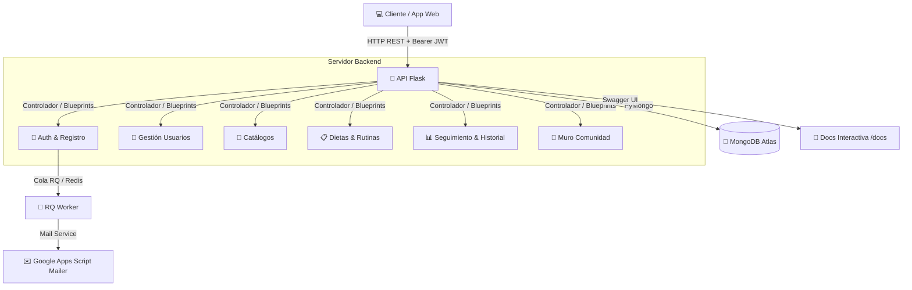
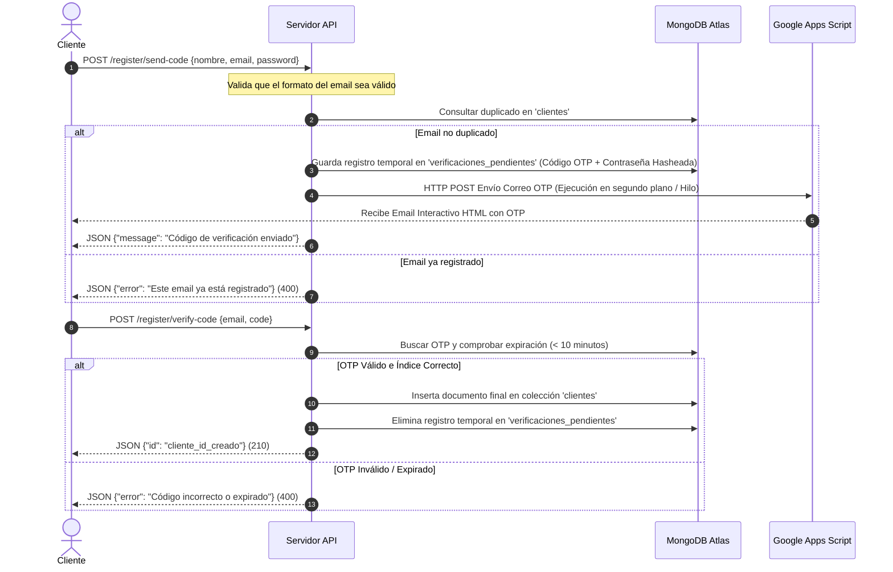

# 🥗 NutriCoach API - Memoria del Proyecto y Guía de Uso

¡Bienvenido a **NutriCoach**! Una plataforma de software integral diseñada para **clientes** y entusiastas del fitness, permitiendo una planificación nutricional avanzada, el diseño de rutinas de entrenamiento físico a medida, el seguimiento minucioso del progreso corporal y una red comunitaria interactiva.

Este repositorio contiene la arquitectura completa del proyecto backend, estructurado en un robusto **Backend en Flask** con base de datos NoSQL en **MongoDB Atlas**.

---

## 🗺️ Índice
1. [🚀 Arquitectura y Tecnologías](#1--arquitectura-y-tecnologías)
2. [🔒 Sistema de Seguridad y Roles](#2--sistema-de-seguridad-y-roles)
3. [📁 Estructura del Código](#3--estructura-del-código)
4. [📊 Diseño de la Base de Datos (Modelos MongoDB)](#4--diseño-de-la-base-de-datos-modelos-mongodb)
5. [📈 Flujos de Trabajo Clave](#5--flujos-de-trabajo-clave)
6. [🛠️ Catálogo Completo de Endpoints (API Specs)](#6--catálogo-completo-of-endpoints-api-specs)
7. [⚙️ Instalación y Puesta en Marcha](#7--instalación-y-puesta-en-marcha)
8. [🖼️ Gestión y Resolución Dinámica de Fotos de Perfil](#8--gestión-y-resolución-dinámica-de-fotos-de-perfil)

---

## 1. 🚀 Arquitectura y Tecnologías

El diseño del sistema sigue un modelo cliente-servidor desacoplado, estructurado en base a servicios web RESTful de alto rendimiento y bajo acoplamiento:



### 🛠️ Stack Tecnológico Utilizado
*   **Lenguaje de Programación:** Python 3.x
*   **Framework Web:** **Flask 3.1.2** como núcleo REST.
*   **Base de Datos:** **MongoDB Atlas** (Base de datos NoSQL en la nube) gestionada mediante **PyMongo 4.16.0**.
*   **Autenticación & Autorización:** **Flask-JWT-Extended 4.7.1** con tokens firmados y claims de rol personalizados.
*   **Validación de Datos:** **jsonschema 4.26.0** para la validación estricta en tiempo de ejecución de las cargas útiles (payloads) HTTP.
*   **Envío de Correos (OTP):** Google Apps Script Web App API para entrega inmediata y gratuita de correos corporativos en formato HTML interactivo.
*   **Gestión de Tareas Asíncronas:** **RQ (Redis Queue) 2.1.0** y **Redis 5.0.1** para encolamiento seguro de correos.
*   **Documentación Interactiva:** **flask-swagger-ui 5.21.0** para renderizar la especificación **OpenAPI 3.0.3** en formato interactivo.

---

## 2. 🔒 Sistema de Seguridad y Roles

NutriCoach cuenta con una capa robusta de seguridad basada en **JSON Web Tokens (JWT)** y control de acceso basado en roles (**RBAC**). Al autenticarse con éxito, el servidor inyecta la información del usuario en los *claims* adicionales del token.

### 🛡️ Decoradores de Control de Acceso (En `utils.py`)

Para garantizar que los recursos permanezcan protegidos, se han implementado decoradores personalizados que interceptan las peticiones:

1.  `@check_auth_any()`: Permite el acceso a cualquier usuario con un JWT válido (ej. interactuar en la comunidad, ver catálogos maestros).
2.  `@check_auth_owner()`: Una regla dinámica avanzada. Permite el paso si el solicitante es el propietario legítimo del recurso que intenta modificar (ej. actualizar su propio peso, cambiar sus metas).

---

## 3. 📁 Estructura del Código

La API está estructurada modularmente mediante **Flask Blueprints**, lo que garantiza un desarrollo limpio, mantenible y escalable.

```bash
API-nutri-coach/
├── blueprints/              # Módulos de rutas y controladores (Blueprints)
│   ├── __init__.py
│   ├── auth.py              # Login, registro y verificación por código OTP de correo
│   ├── catalogos.py         # Catálogo maestro de alimentos y ejercicios
│   ├── comunidad.py         # Posts, likes y comentarios
│   ├── planes.py            # Gestión avanzada de dietas y rutinas (y sus subrecursos)
│   ├── seguimiento.py       # Registro de peso corporal e historial de entrenamientos por series
│   └── usuarios.py          # CRUD de clientes y red de seguidores (follow)
├── .env                     # Variables de entorno locales
├── application.py           # Punto de entrada de la aplicación Flask (configuraciones e inicializaciones)
├── email_service.py         # Motor de envío OTP y validación temporal de pre-registro
├── utils.py                 # Conexión global a MongoDB y decoradores de autenticación
├── documentation.yaml       # Especificación completa OpenAPI 3.0.3 (Swagger)
├── requirements.txt         # Dependencias de producción del servidor backend
└── worker.py                # Worker para tareas de correo en segundo plano
```

---

## 4. 📊 Diseño de la Base de Datos (Modelos MongoDB)

MongoDB almacena los datos de forma flexible e hiper-optimizada. A continuación se detallan las estructuras (esquemas lógicos) de las colecciones principales en `NutricionDB`:

### 🟢 `clientes`
Almacena la información de los usuarios que consumen las dietas y rutinas.
```json
{
  "_id": "ObjectId('65fa3a4fb52b821a8c9b3e10')",
  "nombre": "Juan Pérez",
  "email": "juan@gmail.com",
  "password_hash": "pbkdf2:sha256:600000$...",
  "telefono": "612345678",
  "edad": 28,
  "peso": 78.5,
  "altura": 180.0,
  "genero": "Masculino",
  "objetivo": "Pérdida de grasa",
  "foto_perfil": "http://res.cloudinary.com/dsgu3bw8h/image/upload/v123456/perfil.jpg"
}
```

### 🟡 `verificaciones_pendientes` (Colección Temporal OTP)
Almacena de forma temporal los registros pre-validados mediante correo electrónico.
```json
{
  "_id": "ObjectId('65fa3c4fb52b821a8c9b3e99')",
  "email": "pedro.nuevo@gmail.com",
  "code": "847291",
  "nombre": "Pedro Nuevo",
  "password_hash": "pbkdf2:sha256:600000$...",
  "created_at": "ISODate('2026-05-28T17:03:31Z')" // Expira de forma automática tras 10 minutos
}
```

### 🟠 `dietas`
Diseño de planificación alimentaria con arrays de comidas y alimentos integrados de forma atómica.
```json
{
  "_id": "ObjectId('65fa4201b52b821a8c9b3f20')",
  "nombre": "Dieta Volumen Limpio",
  "cliente_id": "ObjectId('65fa3a4fb52b821a8c9b3e10')",
  "cliente": "Juan Pérez",
  "kcal_objetivo": 2800,
  "notas_generales": "Beber 3 litros de agua al día.",
  "activa": true,
  "publica": false,
  "comidas": [
    {
      "nombre": "Desayuno",
      "hora_sugerida": "08:30",
      "alimentos": [
        {
          "alimento_id": "ObjectId('65fa4001b52b821a8c9b3d05')",
          "nombre_snapshot": "Avena en hojuelas",
          "cantidad": 100.0,
          "unidad": "g"
        }
      ]
    }
  ]
}
```

### 🏋️ `rutinas`
Diseño de planificación de entrenamiento físico.
```json
{
  "_id": "ObjectId('65fa4301b52b821a8c9b3f50')",
  "nombre": "Rutina Push/Pull/Legs",
  "cliente_id": "ObjectId('65fa3a4fb52b821a8c9b3e10')",
  "cliente": "Juan Pérez",
  "activa": true,
  "publica": true,
  "dias": [
    {
      "nombre": "Día 1 - Empuje (Push)",
      "ejercicios": [
        {
          "ejercicio_id": "ObjectId('65fa4101b52b821a8c9b3e99')",
          "nombre_snapshot": "Press de Banca Inclinado",
          "series": 4,
          "repeticiones": 10,
          "descanso_segundos": 90
        }
      ]
    }
  ]
}
```

### 📊 `historial_entrenamientos`
Registro histórico detallado de los entrenamientos reales completados por el cliente.
```json
{
  "_id": "ObjectId('65fa4401b52b821a8c9b3f80')",
  "cliente_id": "ObjectId('65fa3a4fb52b821a8c9b3e10')",
  "rutina_nombre": "Rutina Push/Pull/Legs",
  "dia_nombre": "Día 1 - Empuje (Push)",
  "fecha": "2026-05-28",
  "ejercicios": [
    {
      "ejercicio_id": "ObjectId('65fa4101b52b821a8c9b3e99')",
      "nombre_snapshot": "Press de Banca Inclinado",
      "series": [
        { "repeticiones": "10", "peso": 80.0, "descanso_segundos": 90 },
        { "repeticiones": "8", "peso": 85.0, "descanso_segundos": 90 }
      ]
    }
  ]
}
```

### 💬 `posts` (Comunidad)
Red social integrada para compartir experiencias y planes.
```json
{
  "_id": "ObjectId('65fa4501b52b821a8c9b3fc0')",
  "autor_id": "ObjectId('65fa3a4fb52b821a8c9b3e10')",
  "autor_nombre": "Juan Pérez",
  "texto": "¡Hoy he completado mi entrenamiento de pierna! Comparto mi rutina pública.",
  "rutina_id": "ObjectId('65fa4301b52b821a8c9b3f50')",
  "dieta_id": null,
  "imagen_url": "http://res.cloudinary.com/imagen.jpg",
  "likes": 12,
  "liked_by": [
    "ObjectId('65fa3a4fb52b821a8c9b3e01')"
  ],
  "comentarios": [
    {
      "autor_id": "ObjectId('65fa3a4fb52b821a8c9b3e01')",
      "autor_nombre": "Dra. María López",
      "texto": "¡Excelente técnica de sentadilla hoy!",
      "fecha": "2026-05-28T18:04:12Z"
    }
  ],
  "fecha_creacion": "2026-05-28T17:55:00Z",
  "activa": true
}
```

---

## 5. 📈 Flujos de Trabajo Clave

### A. Registro de Clientes Seguro por Código OTP de Email
Evita la inyección de cuentas falsas o correos spam obligando al cliente a validar un código generado dinámicamente y enviado a su Gmail en tiempo real.



### B. Sistema de Muro Social y Compartición de Planes
Los usuarios pueden subir publicaciones al muro comunitario, vincular planes de dieta o rutinas que tengan marcadas como **públicas**, dar *likes* de forma interactiva (toggle on/off) y comentar en hilos dinámicos.

---

## 6. 🛠️ Catálogo Completo de Endpoints (API Specs)

La API cuenta con la documentación interactiva en el endpoint `/docs` (Swagger UI). A continuación se resumen todos los endpoints de la API ordenados por módulos y sus permisos.

### 📑 Paginación Global de Colecciones
Para evitar problemas de falta de memoria (Out of Memory / OOM) y ataques DDoS accidentales bajo altas cargas de datos, todos los endpoints que listan colecciones (usuarios, alimentos, ejercicios, dietas, rutinas e historial de entrenamiento) implementan **paginación por offset**.
*   **Parámetros aceptados:**
    *   `skip` (opcional, por defecto `0`): Número de elementos a omitir.
    *   `limit` (opcional, por defecto `50`): Límite máximo de elementos devueltos por petición.

### 🔑 Autenticación y Registro (`auth_bp`)

| Método | Endpoint | Permiso | Descripción |
| :--- | :--- | :--- | :--- |
| `POST` | `/login` | Público | Autentica al usuario. Retorna un JWT de acceso (válido 24 horas) y el rol. |
| `POST` | `/register/send-code` | Público | Valida datos básicos de registro y envía un código de 6 dígitos a un correo electrónico válido. |
| `POST` | `/register/verify-code` | Público | Valida el código temporal enviado. Si es correcto, da de alta al cliente de manera formal. |
| `POST` | `/register/resend-code` | Público | Genera y reenvía un nuevo código OTP a una solicitud pendiente de registro. |

### 👤 Usuarios y Seguimiento de Red (`usuarios_bp`)

| Método | Endpoint | Permiso | Descripción |
| :--- | :--- | :--- | :--- |
| `GET` | `/clientes` | Público | Devuelve la lista de clientes (excluye contraseña), incluyendo número de seguidores/seguidos. |
| `POST` | `/clientes` | Público | Creación directa de cliente sin verificación por email (bypass administrativo). |
| `GET` | `/clientes/<id>` | Público | Obtiene el perfil detallado de un cliente. |
| `PUT` | `/clientes/<id>` | Propietario | Modifica los datos de perfil de un cliente (edad, peso, altura, objetivo). |
| `DELETE` | `/clientes/<id>` | Propietario | Elimina a un cliente de la base de datos de manera irreversible. |
| `POST` | `/clientes/<id>/seguir` | Autenticado | Comienza a seguir a un cliente (sistema de red social interna). |
| `DELETE` | `/clientes/<id>/seguir` | Autenticado | Deja de seguir a un cliente. |
| `GET` | `/clientes/<id>/seguidores` | Público | Lista los seguidores del cliente. |
| `GET` | `/clientes/<id>/seguidos` | Público | Lista a los clientes que sigue el usuario. |

### 🥗 Catálogos Maestros (`catalogos_bp`)

| Método | Endpoint | Permiso | Descripción |
| :--- | :--- | :--- | :--- |
| `GET` | `/alimentos` | Público | Obtiene la lista completa del catálogo de alimentos y sus macronutrientes. |
| `GET` | `/alimentos/<id>` | Público | Obtiene el detalle de un alimento individual. |
| `POST` | `/alimentos` | Autenticado | Registra un nuevo alimento con calorías, carbohidratos, grasas y proteínas. |
| `PUT` | `/alimentos/<id>` | Autenticado | Modifica los macronutrientes o datos de un alimento. |
| `DELETE` | `/alimentos/<id>` | Autenticado | Elimina un alimento del catálogo maestro. |
| `GET` | `/ejercicios` | Público | Lista todos los ejercicios cargados en el catálogo de entrenamiento. |
| `GET` | `/ejercicios/<id>` | Público | Obtiene la descripción e instrucciones de un ejercicio por ID. |
| `POST` | `/ejercicios` | Autenticado | Crea un ejercicio especificando grupo muscular y duración recomendada. |
| `PUT` | `/ejercicios/<id>` | Autenticado | Modifica los datos de un ejercicio. |
| `DELETE` | `/ejercicios/<id>` | Autenticado | Elimina un ejercicio del catálogo de entrenamiento. |

### 📋 Gestión de Dietas y Rutinas (`planes_bp`)

> [!NOTE]
> Para la eliminación de dietas y rutinas, la API implementa **borrado lógico (soft delete)** marcando el atributo `activa: false` en sus respectivas colecciones. Esto hace que dejen de listarse en el panel personal del usuario creador. Sin embargo, las referencias `dieta_id` y `rutina_id` en la colección `posts` se preservan de forma deliberada. Puesto que los endpoints de consulta individual por ID (`GET /dietas/<id>` y `GET /rutinas/<id>`) no discriminan el estado activo del documento, **el plan sigue siendo totalmente accesible, visualizable y replicable por otros usuarios desde el feed social de la comunidad**, garantizando la completa preservación del conocimiento y de la interacción histórica.

| Método | Endpoint | Permiso | Descripción |
| :--- | :--- | :--- | :--- |
| `GET` | `/clientes/<id>/dietas` | Público | Obtiene todas las dietas del cliente (incluyendo inactivas e históricas). |
| `GET` | `/clientes/<id>/dietas-activas` | Público | Obtiene la planificación nutricional activa asignada al cliente. |
| `GET` | `/dietas/publicas` | Público | Lista global de todas las dietas compartidas como públicas por los usuarios. |
| `GET` | `/dietas/<id>` | Público | Detalle completo de una dieta y su desglose calórico. |
| `POST` | `/dietas` | Autenticado | Crea una dieta para un cliente (el cliente solo puede crear para sí mismo). |
| `PUT` | `/dietas/<id>` | Propietario / Nutri | Modifica las propiedades generales de una dieta. |
| `DELETE` | `/dietas/<id>` | Propietario / Nutri | Desactiva una dieta del sistema (Soft Delete / `activa: false`). |
| `POST` | `/dietas/<id>/comidas` | Propietario / Nutri | Agrega un menú de comida (ej. Cena, Post-entrenamiento) a una dieta. |
| `DELETE` | `/dietas/<id>/comidas/<idx>` | Propietario / Nutri | Elimina por completo una comida de la dieta mediante su índice numérico. |
| `POST` | `/dietas/<id>/comidas/<idx>/alimentos` | Propietario / Nutri | Agrega un alimento del catálogo a la comida, detallando cantidad y unidad. |
| `DELETE` | `/dietas/<id>/comidas/<c_idx>/alimentos/<a_idx>` | Propietario / Nutri | Elimina un alimento específico dentro de una comida según su índice. |
| `GET` | `/clientes/<id>/rutinas` | Público | Obtiene las rutinas del cliente (si es un tercero, solo devuelve las marcadas como públicas). |
| `GET` | `/clientes/<id>/rutinas-activas` | Público | Obtiene la planificación deportiva del cliente marcada como activa. |
| `GET` | `/rutinas/publicas` | Público | Lista global de todas las rutinas compartidas con la comunidad. |
| `GET` | `/rutinas/<id>` | Público | Detalle completo de una rutina y su orden diario de ejercicios. |
| `POST` | `/rutinas` | Autenticado | Crea una nueva rutina (el cliente solo puede crear para sí mismo). |
| `PUT` | `/rutinas/<id>` | Propietario / Nutri | Modifica atributos globales de la rutina. |
| `DELETE` | `/rutinas/<id>` | Propietario / Nutri | Desactiva una rutina del sistema (Soft Delete / `activa: false`). |
| `POST` | `/rutinas/<id>/dias` | Propietario / Nutri | Añade un día de entrenamiento (ej. Lunes - Pecho) a la rutina. |
| `DELETE` | `/rutinas/<id>/dias/<idx>` | Propietario / Nutri | Elimina un día de entrenamiento de la rutina mediante su índice. |
| `POST` | `/rutinas/<id>/dias/<idx>/ejercicios` | Propietario / Nutri | Añade un ejercicio al día de la rutina. **Previene duplicados en un mismo día.** |
| `DELETE` | `/rutinas/<id>/dias/<d_idx>/ejercicios/<e_idx>` | Propietario / Nutri | Quita un ejercicio del entrenamiento del día según su índice. |

### 📊 Seguimiento Físico e Historiales (`seguimiento_bp`)

| Método | Endpoint | Permiso | Descripción |
| :--- | :--- | :--- | :--- |
| `POST` | `/seguimientos` | Autenticado | Registra el peso actual de un cliente en una fecha específica para seguimiento de progreso. |
| `GET` | `/seguimientos/<id>` | Propietario / Nutri | Obtiene el detalle de un registro de progreso individual (peso y notas corporales). |
| `POST` | `/clientes/<id>/historial-entrenamientos` | Propietario / Nutri | Registra la finalización de un entrenamiento real, guardando pesos y repeticiones por serie. |
| `GET` | `/clientes/<id>/historial-entrenamientos` | Propietario / Nutri | Obtiene la lista histórica de todos los entrenamientos realizados, ordenados por los más recientes. |

### 💬 Comunidad e Interacción Social (`comunidad_bp`)

| Método | Endpoint | Permiso | Descripción |
| :--- | :--- | :--- | :--- |
| `GET` | `/posts` | Público | Lista posts activos y públicos en la comunidad con **paginación basada en cursor** (orden descendente por `fecha_creacion`). Acepta parámetros de consulta opcionales `limit` (por defecto 10, máx 50) y `cursor` (timestamp ISO `fecha_creacion` del último post cargado). |
| `GET` | `/posts/<id>` | Público | Obtiene un post en específico y sus comentarios. Utilizado para sincronizaciones de interacciones directas sin refrescar todo el muro. |
| `POST` | `/posts` | Autenticado | Crea una publicación con texto. Opcionalmente adjunta una imagen (Cloudinary URL) o planes públicos. |
| `DELETE` | `/posts/<id>` | Propietario | Realiza un borrado lógico del post del muro (`activa: false`). Solo permitido al autor del post. |
| `POST` | `/posts/<id>/like` | Autenticado | Sistema Toggle de Me Gusta (añade un like si no lo tenía, o lo quita si ya existía). |
| `POST` | `/posts/<id>/comentarios` | Autenticado | Agrega un comentario en formato de texto a la publicación. |
| `DELETE` | `/posts/<id>/comentarios/<idx>` | Autor Post / Autor Com | Elimina el comentario mediante su índice en el array. Solo permitido al autor del post o del comentario. |

---

## 7. ⚙️ Instalación y Puesta en Marcha

Sigue estos sencillos pasos para levantar el entorno de desarrollo en tu ordenador local:

### Requisitos Previos
*   Tener instalado **Python 3.8** o superior.
*   Contar con un clúster de base de datos en **MongoDB Atlas** (o una base de datos local MongoDB ejecutándose).

### Pasos de Instalación y Ejecución

1.  Instala todas las dependencias requeridas del sistema:
    ```bash
    pip install -r requirements.txt
    ```
2.  Configura tus variables de entorno en un archivo `.env` o en el sistema para enlazar tus servicios:
    *   `MONGODB_CONNECTION_STRING`: Tu URI de conexión a tu base de datos de MongoDB Atlas.
    *   `SECRET_KEY`: Una cadena segura para encriptar los tokens JWT del sistema.
    *   `GMAIL_WEB_APP_URL`: La URL del Web App de Google Apps Script para el envío automatizado de correos OTP.
3.  Levanta la aplicación localmente:
    ```bash
    python application.py
    ```
    *El servidor se levantará de forma automática en http://localhost:5000*
4.  **Ejecutar el Servidor de Tareas Asíncronas (Redis + RQ Worker):**
    *   Asegúrate de tener un servidor de **Redis** ejecutándose (ej. `redis-server`).
    *   Inicia el worker de RQ para procesar la cola de correos electrónicos en una terminal paralela:
        ```bash
        python worker.py
        ```
5.  **Verificación de Funcionamiento:**
    *   Abre tu navegador e ingresa a `http://localhost:5000/docs`. Deberías visualizar de forma automática el dashboard interactivo de **Swagger UI** con toda la especificación cargada correctamente.

---

## 🖼️ 8. Gestión y Resolución Dinámica de Fotos de Perfil

Para complementar la experiencia social y la personalización de usuarios, la API implementa soporte completo para **fotos de perfil**.

### A. Almacenamiento y Validación
*   Las fotos de perfil se guardan en la colección `clientes` bajo el campo `"foto_perfil"`, el cual almacena una URL string absoluta de la imagen subida.
*   En `blueprints/usuarios.py`, se actualizó el esquema de validación JSON Schema para soportar y verificar `"foto_perfil"` en los endpoints de creación y modificación de perfiles:
    *   `POST /clientes`
    *   `PUT /clientes/<id>`

### B. Optimización de Feeds de Comunidad (Dynamic Lookup Joins)
Para evitar la duplicidad de urls estáticas en cada post y prevenir enlaces obsoletos (stale URLs) si un usuario decide cambiar su foto de perfil posterior a la creación de un post, se ha diseñado una resolución en tiempo real:
*   En `blueprints/comunidad.py`, al consultar el listado de publicaciones (`GET /posts` y `GET /posts/<id>`), el backend recopila de forma única los `autor_id` del lote de posts.
*   Realiza una consulta masiva optimizada utilizando `$in` para traer en un solo paso la propiedad `foto_perfil` actualizada de la colección `clientes`.
*   Asocia dinámicamente este enlace inyectando el campo `autor_foto_perfil` en la respuesta JSON final de cada post, logrando consistencia instantánea en toda la red social.

---

> [!TIP]
> **Autores del Proyecto:**
> Sergio Peralvarez & Jorge Moros
> *Desarrollo de Aplicaciones Multiplataforma (2º DAM)*
